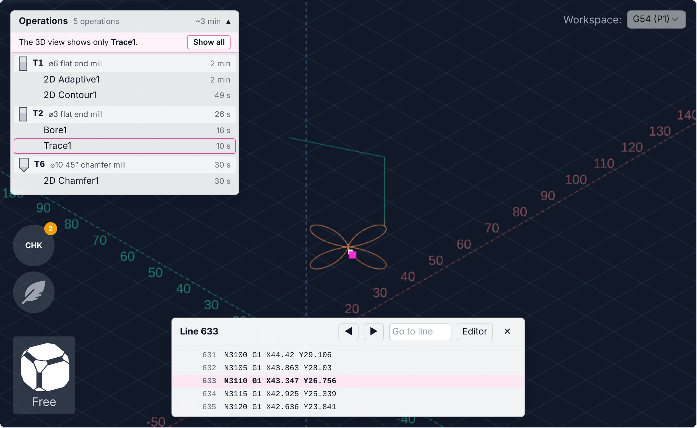

<!-- GGSender: this file replaces upstream's README. Upstream's own is at
     https://github.com/Sienci-Labs/gsender#readme and in the tag v1.6.4 of this repository. -->

# GGSender

**gSender for a FluidNC machine with a fixed tool length sensor: tool changes that say what they
will do, a resume that works after a broken bit, and a 3D view that knows your operations.**

GGSender is a personal fork of [gSender](https://github.com/Sienci-Labs/gsender) 1.6.4 by Sienci
Labs. It is made for one hobby CNC router that runs [FluidNC](https://github.com/bdring/FluidNC),
connects to gSender as Grbl, and cuts programs from Fusion with several tools. Each change in it
answers something that went wrong, or was not clear, at that machine.


> [!IMPORTANT]
> This is not an official gSender build. Sienci Labs does not support it: do not report problems
> with it to them. It moves a machine. Make an air cut after each update.

## What it adds

### Tool changes that you can read before you press Run

With a fixed tool sensor, gSender keeps one number: where a tool reads on the sensor. That number
is correct only while Z zero stays where it was. GGSender tracks it.

- It records **which tool was probed, when, and whether the reference is still correct**.
- It sees a **Z zero set by hand**, from the pendant too, within a few seconds.
- At each tool change it **decides from that state, says why, and lets you overrule it**.
- The window shows **a drawing of the tool** to fit, from the tool table that Fusion writes.
- A resumed job never takes the "first tool" shortcut that skips the new tool.

| The tool change window | The reference, with its history |
| --- | --- |
|  |  |

### Resume From: back into a job after a stop


A bit breaks, the link drops, or you stop the job. **Resume From** starts again at a line that you
select, and shows everything before anything moves.

- It proposes **the move the tool was on** when the job stopped.
- You can also select the **start of an operation**, or the **line you clicked in the 3D view**.
- Three clear tool choices: same tool, new tool, or Z zero set again by hand.
- It rebuilds the state of the program at that line: units, plane, work coordinate system, tool
  length offset, feed, spindle, coolant.
- It shows **every line that it will send** before the line, and where the tool comes down.
- With no reference (after a reconnection), it measures the tool first, so a later broken bit can
  be replaced by measurement.

<br clear="right">

### Operations in the 3D view

The operations of the program, in groups for each tool, with times and the time to the next tool
change. **Click an operation to see only its toolpath.** Click a move to get its G-code line.

| All toolpaths | One operation alone, one move selected |
| --- | --- |
|  |  |

### Stops that stop

- **Pause is an immediate feed hold.** Upstream first runs what is in the controller's buffer.
- While held, **stop and start the spindle** from the screen. Resume waits for the spin-up.
- **The machine holds at the first error of a job.** Upstream keeps sending lines.
- **Feed and spindle overrides go back to 100% at each operation**, if you want that.

### Checks before the job

A pre-flight report for every loaded file, behind the **CHK** button:

- per tool: deepest cut, highest feed, spindle speeds;
- the job against the travel of the machine, in machine coordinates;
- a feed move before any feed rate, a plunge with the spindle off, a rapid that ends below Z0;
- the first tool against the tool that is in the spindle.

### Smaller things

- **Feed and speed rules for each tool**, for example `T5 F>800 -> F800`, changeable during a job.
- Feed and spindle overrides in **1% steps**; the feed slider goes down to 10%.
- The tool change keeps Z at a **safe height that you set**, and does not plunge back.
- gSender tracks the tool number and does not send the T word. Grbl firmware refuses numbers
  above 255.
- Coordinate fields accept calculations: `(120-6)/2`.
- A large **Run** button in the tool change window, and Enter presses it.
- A **traffic log** of everything sent and received, to find the cause of a stall.
- The text that the fork adds is in plain, short sentences (ASD-STE100 style).

Every new behaviour has a setting in **Config**, in the GGSender section, and the upstream
behaviour stays available.

## Install

You need Windows and the official gSender 1.6.4.

1. Install [official gSender 1.6.4](https://github.com/Sienci-Labs/gsender/releases/tag/v1.6.4)
   and close it.
2. Download `app.asar` from the [latest release](../../releases/latest) of this repository.
3. In `C:\Program Files\gSender\resources\`, rename `app.asar` to `app.asar.stock`.
4. Copy the downloaded `app.asar` into that folder.
5. Start gSender. The window title reads `GGSender <version> (gSender 1.6.4)`.

To go back, delete `app.asar` and rename `app.asar.stock` to `app.asar`.

Only that one file is replaced. Your settings stay. The fork does not check for updates and does
not send crash reports.

Try it without a machine: load [`examples/gg/demo-plate.nc`](examples/gg/demo-plate.nc), the program in
the first picture.

## How it is checked

The machine cannot be reached from where the code is written, so tests are the first check.

- About **680 automated tests**. Everything that makes, filters or reads G-code has unit tests.
- The **real controller code against a simulated board** that answers like Grbl, with a planner
  queue, a work offset and a tool sensor.
- The **built app driven in a browser** against a fake FluidNC over TCP: the broken-bit case, the
  resume choices, the 3D view compared pixel by pixel.
- A **checklist for the machine** with each version, done as air cuts by the owner.

What was not checked is written down with each version.

## Limits

- One machine, one way of working: FluidNC as Grbl, a fixed tool sensor, Fusion programs, Windows.
- Based on gSender 1.6.4. It does not follow newer gSender versions by itself.
- grblHAL, laser and rotary use are not changed and not tested here.

## For developers

| File | What it is |
| --- | --- |
| [`GGSENDER.md`](GGSENDER.md) | Every change and why, the build recipe, the traps, the machine checklists, the backlog |
| [`CLAUDE.md`](CLAUDE.md) | The short rules for working on the fork |
| `src/app/src/lib/gg/`, `src/app/src/features/gg/`, `src/server/lib/gg/` | The fork's own code. Edits to upstream files are a few lines marked `GGSender:` |
| `scripts/gg/` | Build, packaging, type check, and the end-to-end scripts |

```bash
bun install --ignore-scripts
node_modules/.bin/jest --config jest.config.js     # tests
scripts/gg/typecheck.sh                             # files of the fork: 0 type errors
scripts/gg/build.sh                                 # build into dist/gsender
scripts/gg/fetch-stock-asar.sh stock/app.asar       # the official 1.6.4 archive, verified
node scripts/gg/pack-asar.mjs --stock stock/app.asar --out app.asar
```

`gg/main` is the current state. A pull request into it runs the tests and builds an `app.asar` to
try. A new version on `gg/main` is published as a release.

## Licence and credit

gSender is the work of [Sienci Labs](https://sienci.com) and its contributors, under the
[GNU GPL v3](LICENSE). GGSender is under the same licence. All credit for gSender itself goes to
them: this fork only adds to it.
