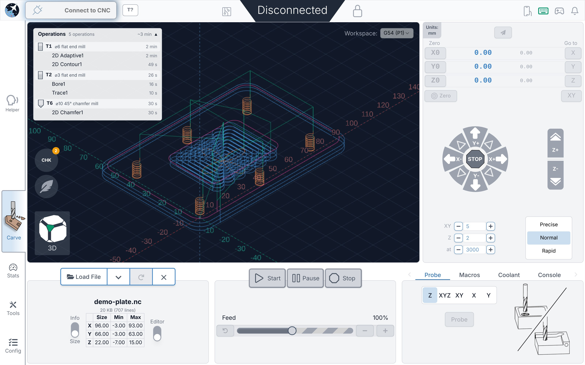
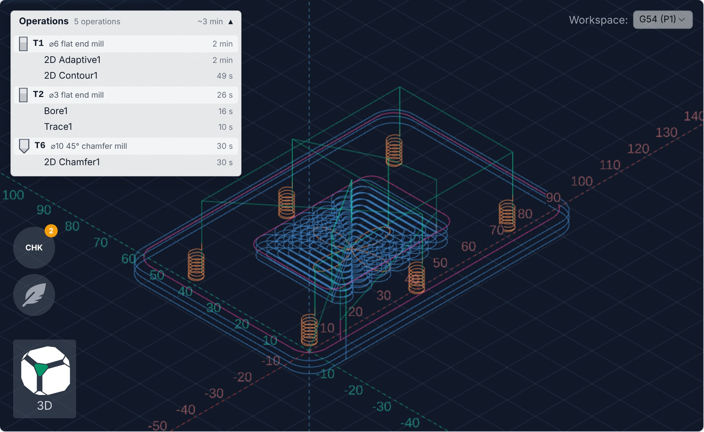
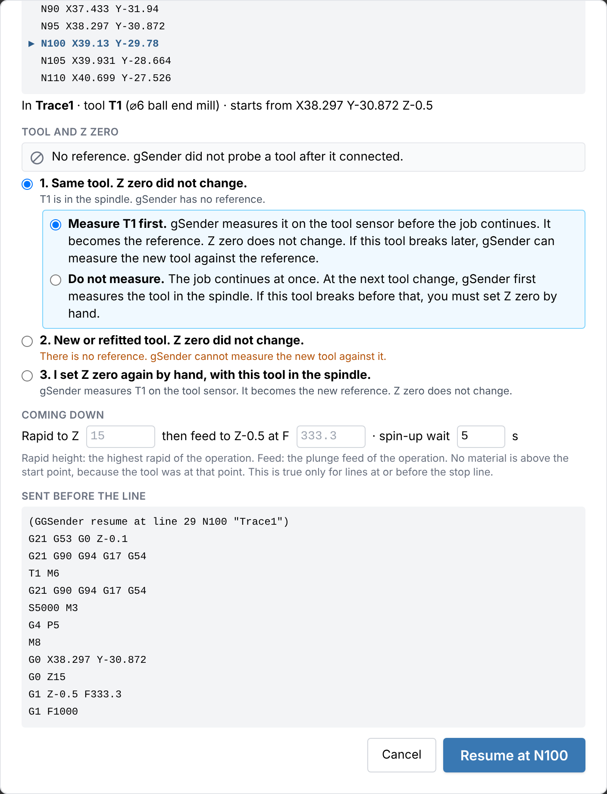
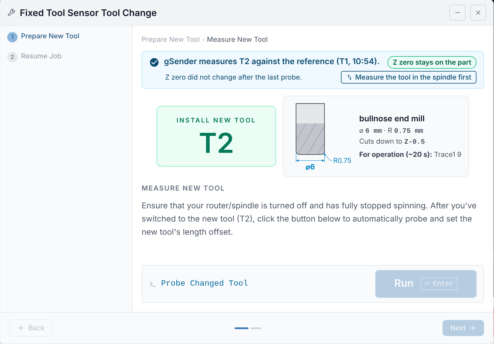
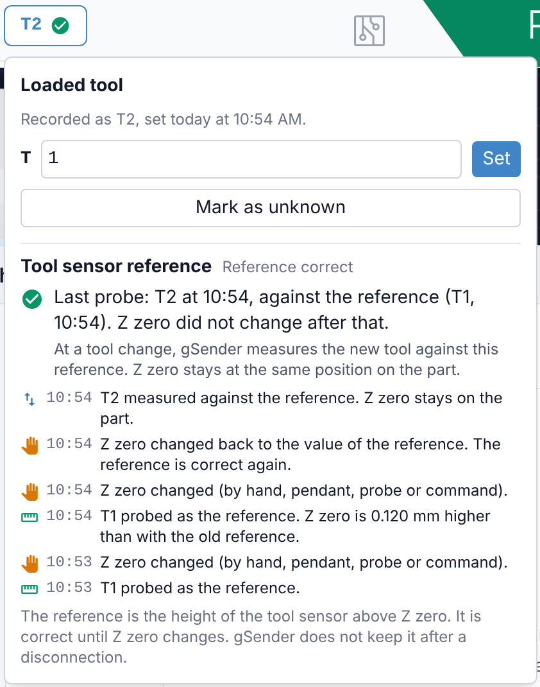

<!-- GGSender: this file replaces upstream's README. Upstream's own is at
     https://github.com/Sienci-Labs/gsender#readme and in the tag v1.6.4 of this repository. -->

# GGSender

**gSender with a 3D view that you can click, a check of the program before it runs, a job that you
can resume from any line, and tool changes that say what they will do.**

GGSender is a fork of [gSender](https://github.com/Sienci-Labs/gsender) 1.6.4 by Sienci Labs, for
machines that run Grbl or [FluidNC](https://github.com/bdring/FluidNC). It adds the things below to
gSender. Nearly every addition has a setting, and gSender's own behaviour stays available, so you
can turn on only what you want.



> [!IMPORTANT]
> This is not an official gSender build. Sienci Labs does not support it: do not report problems
> with it to them. It moves a machine. Make an air cut after each update.

## What you get

| If you have | You get |
| --- | --- |
| Any Grbl or FluidNC machine | Click the toolpath to find the G-code line. A check of each program before it runs. A resume from any line. A pause that stops at once. A hold at the first error. |
| A fixed tool length sensor | Tool changes that track the reference, tell you what they will do, and see a Z zero that you set by hand. |
| Programs from Fusion | A list of the operations in the 3D view, with times and tools. Click an operation to see only its toolpath. A drawing of each tool at the tool change. |
| Another CAM program | The operation names work when the post writes a comment before each operation. The rest needs a small addition: [help is welcome](#other-post-processors). |

## For every machine

### Click the toolpath, get the line

Click a move in the 3D view. GGSender shows the G-code line that makes it, with the lines around
it. Step to the next or previous move, or open the editor at that line. It works the other way
too: click a line number in the editor to see its move.

| All toolpaths | One operation alone, one move selected |
| --- | --- |
|  |  |

### A check before the job

Each loaded file gets a report, behind the **CHK** button:

- the job against the travel of your machine, in machine coordinates;
- a feed move before any feed rate, a plunge with the spindle off, a rapid that ends below Z0;
- for each tool: deepest cut, highest feed, spindle speeds;
- the first tool against the tool that is in the spindle.

### Resume From: back into a job after a stop



A bit breaks, the connection drops, or you stop the job. **Resume From** starts again at a line
that you select, and shows everything before anything moves.

- It proposes **the move the tool was on** when the job stopped.
- You can also select the **start of an operation**, or the **line you clicked in the 3D view**.
- It rebuilds the state of the program at that line: units, plane, work coordinate system, tool
  length offset, feed, spindle, coolant.
- It shows **every line that it will send** before the line, and where the tool comes down.
- It asks what happened to the tool: same tool, new tool, or Z zero set again by hand.

<br clear="right">

### Stops that stop

- **Pause is an immediate feed hold.** Upstream first runs what is in the controller's buffer.
- While held, **stop and start the spindle** from the screen. Resume waits for the spin-up.
- **The machine holds at the first error of a job.** Upstream keeps sending lines.
- **Feed and spindle overrides go back to 100% at each operation**, if you want that.

### Smaller things

- **Feed and speed rules for each tool**, for example `T5 F>800 -> F800`, changeable during a job.
- Feed and spindle overrides in **1% steps**; the feed slider goes down to 10%.
- Coordinate fields accept calculations: `(120-6)/2`.
- A **traffic log** of everything sent and received, to find the cause of a stall.
- The text that the fork adds is in plain, short sentences (ASD-STE100 style).

## For a fixed tool length sensor

With a fixed sensor, gSender keeps one number: where a tool reads on the sensor. That number is
correct only while Z zero stays where it was. GGSender tracks it, so a tool change cannot move your
Z zero without telling you.

- It records **which tool was probed, when, and whether the reference is still correct**.
- It sees a **Z zero set by hand**, from a pendant too, within a few seconds.
- At each tool change it **decides from that state, says why, and lets you overrule it**.
- A resumed job never takes the "first tool" shortcut that skips the new tool.
- The tool change keeps Z at a **safe height that you set**, and does not plunge back.
- gSender tracks the tool number and does not send the T word. Grbl firmware refuses numbers
  above 255.
- A large **Run** button in the tool change window, and Enter presses it.

| The tool change window | The reference, with its history |
| --- | --- |
|  |  |

## For programs from Fusion

Fusion's posts write the tools and the operation names into the program as comments:

```
(T45 D=4 CR=0.5 - ZMIN=-5.8 - bullnose end mill)
...
(3D Adaptive Roughing1)
N15 T45 M6
```

GGSender reads them. You get:

- **The operations in the 3D view**, in groups for each tool, with times and the time to the next
  tool change.
- **Click an operation to see only its toolpath.** A click on the toolpath then finds only moves of
  that operation. This helps when toolpaths lie over each other.
- **A drawing of the tool** in the tool change window: diameter, corner radius, taper, and the
  operations it is for.
- **Resume From the start of an operation.**

### Other post processors

Changes that add other post processors are welcome.

- **Operation names** already work for any post that writes a comment on its own line before each
  operation.
- **The tool table** is read in Fusion's form only. Another form needs an addition to
  [`src/app/src/lib/gg/toolSpec.ts`](src/app/src/lib/gg/toolSpec.ts).
- **Other ways to mark operations** go in
  [`src/app/src/lib/gg/jobOperations.ts`](src/app/src/lib/gg/jobOperations.ts). Its header gives
  the rules it uses now.

To add one: put a short sample program from your post in
`src/app/src/lib/gg/__tests__/fixtures/`, add tests next to the existing ones, and open a pull
request. If you cannot write the code, open an issue with a sample program: that is already a help.

## What it works with

| | State |
| --- | --- |
| Grbl 1.1 and FluidNC (gSender's Grbl controller) | All features. Proven on FluidNC 4.1, over USB and over Wi-Fi. |
| grblHAL | Not yet. gSender has a separate controller for grblHAL, and the fork's job features are in the Grbl one. A port is welcome. |
| Fusion | All features. |
| Other CAM programs | Everything except the tool table and the tool drawings. See above. |
| Windows | A ready `app.asar` with each release. |
| macOS, Linux | No ready file. The code is the same: build it from source. Not tested. |

It is based on gSender 1.6.4 and does not follow newer gSender versions by itself. Laser and
rotary use are not changed and not tested.

## Install

You need Windows and the official gSender 1.6.4.

1. Install [official gSender 1.6.4](https://github.com/Sienci-Labs/gsender/releases/tag/v1.6.4)
   and close it.
2. Download `app.asar` from the [latest release](../../releases/latest) of this repository.
3. In `C:\Program Files\gSender\resources\`, rename `app.asar` to `app.asar.stock`.
4. Copy the downloaded `app.asar` into that folder.
5. Start gSender. The window title reads `GGSender <version> (gSender 1.6.4)`.

To go back, delete `app.asar` and rename `app.asar.stock` to `app.asar`.

Only that one file is replaced. Your settings stay. The fork does not check for updates and does
not send crash reports. All its settings are in **Config**, in the GGSender section.

Try it without a machine: load [`examples/gg/demo-plate.nc`](examples/gg/demo-plate.nc), the
program in the first picture.

## How it is checked

Each change is tested before it reaches a machine.

- About **690 automated tests**. Everything that makes, filters or reads G-code has unit tests.
- The **real controller code against a simulated board** that answers like Grbl, with a planner
  queue, a work offset and a tool sensor.
- The **built app driven in a browser** against a fake FluidNC over TCP: a broken bit, the resume
  choices, the 3D view compared pixel by pixel.
- A **checklist for the machine** with each version, done as air cuts on a FluidNC router.
- The release file is built on GitHub from this source, and its checksum is published with it.

What was not checked is written down with each version, in [`GGSENDER.md`](GGSENDER.md).

## Contribute

Changes are welcome, and so are reports of what does not work on your machine. The most useful:

- **another post processor** (see [above](#other-post-processors));
- **grblHAL**: the job features in gSender's grblHAL controller;
- **macOS and Linux**: a packaged file, and someone to test it;
- **your traffic log** when something goes wrong: it shows every line sent and received.

The rules are short. Anything that touches G-code gets a test. A new behaviour gets a setting, and
gSender's own behaviour stays available. A pull request into `gg/main` runs the tests and builds
an `app.asar` that you can try.

| File | What it is |
| --- | --- |
| [`GGSENDER.md`](GGSENDER.md) | Every change and why, the build recipe, the traps, the machine checklists, the backlog |
| [`CLAUDE.md`](CLAUDE.md) | The short rules for working on the fork |
| `src/app/src/lib/gg/`, `src/app/src/features/gg/`, `src/server/lib/gg/` | The fork's own code. Edits to upstream files are a few lines marked `GGSender:` |
| `scripts/gg/` | Build, packaging, type check, and the end-to-end scripts |

```bash
bun install --ignore-scripts
node_modules/.bin/jest --config jest.config.js     # tests
scripts/gg/typecheck.sh                             # files of the fork: 0 type errors
scripts/gg/build.sh                                 # build into dist/gsender
scripts/gg/fetch-stock-asar.sh stock/app.asar       # the official 1.6.4 archive, verified
node scripts/gg/pack-asar.mjs --stock stock/app.asar --out app.asar
```

## Licence and credit

gSender is the work of [Sienci Labs](https://sienci.com) and its contributors, under the
[GNU GPL v3](LICENSE). GGSender is under the same licence. All credit for gSender itself goes to
them: this fork only adds to it.
